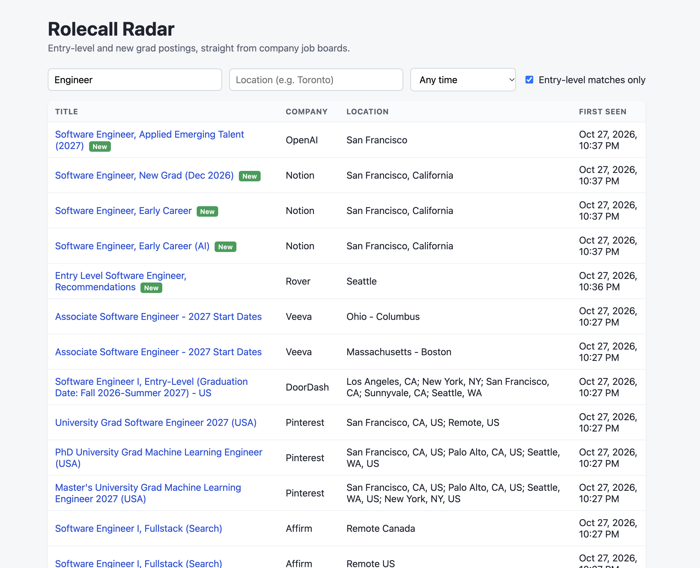
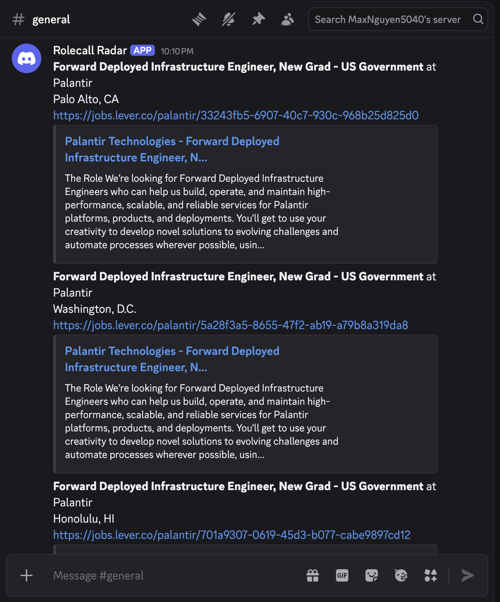
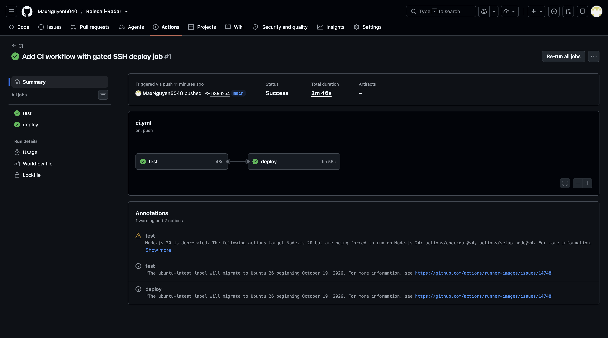
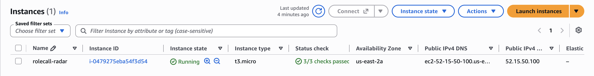

# Rolecall Radar

I wanted to see entry level and new grad postings before they show up on LinkedIn, so I built a service that watches company job boards for me. It polls the Greenhouse, Lever and Ashby boards of 20 companies every hour, saves each posting once in Postgres, and sends a Discord message when a new one looks like an entry level or new grad role in Toronto, Canada or the US.



## What it does

- Polls 20 company boards (8 Greenhouse, 5 Lever, 7 Ashby) on an hourly cron.
- Dedupes with a unique key on company and posting ID, so each job is stored and alerted on once.
- Treats the first poll of a new company as a silent baseline, so adding a company doesn't flood Discord with its whole backlog.
- Posts matching new jobs to a Discord webhook, with Canada postings tagged `[Canada]`.
- Serves a small React dashboard with filters for role, location and date, plus a "new since last visit" view.
- Keeps going when a board is down. Requests time out after 10 seconds, retry twice, and are throttled to one per second per host. Every poll is recorded in a `PollRun` table.



## How the filters work

A posting matches when the title looks entry level and the location is in Canada, the US, or remote.

- Title keywords: new grad, entry level, early career, junior, university grad, "Engineer I", or a 2027 start date.
- Titles with senior, staff, principal, lead, manager, director, intern or co-op are dropped.
- Locations: Canada (Toronto, Ontario and a few nearby cities), US states and big cities, or plain "Remote".

The rules live in [src/filters.ts](src/filters.ts) and are covered by unit tests.

## Stack

TypeScript, Node.js, Express, Zod, PostgreSQL with Prisma, node-cron, React (Vite), Vitest, Docker Compose, GitHub Actions, AWS EC2.

## Run it

You need Node 22+ and Docker.

```bash
cp .env.example .env          # add DISCORD_WEBHOOK_URL
docker compose up -d db
npm install
npx prisma migrate dev
npm run seed                  # load companies
npm run poll                  # poll once (the first poll per company is a silent baseline)
npm run dev                   # API plus hourly scheduler
```

For the dashboard in dev, run `npm run dev` in `web/` too (it proxies to the API on port 3000). To run everything the way production does, use `docker compose up -d --build` and open http://localhost:3000.

## API

| Endpoint | What it returns |
|---|---|
| `GET /health` | `{ status: "ok" }` if the database answers |
| `GET /companies` | Every company with its posting count and last poll |
| `GET /postings` | Postings, newest first. Query params: `q`, `location`, `since`, `ats`, `matched`, `limit` |

## Tests and CI

```bash
npm test
```

47 tests cover the filters, the three ATS parsers (against saved real responses), dedupe and the baseline rule, and the API. They hit a real Postgres database.

GitHub Actions runs lint, typecheck, the tests and the dashboard build on every push. On `main` it can also deploy over SSH to the EC2 box, which pulls the repo and rebuilds with `docker compose up -d --build`.

## Deployment

I ran it on a free plan EC2 `t3.micro` (Ubuntu 24.04) with Docker Compose, deployed from GitHub Actions.




## Metrics

```bash
docker compose exec -T db psql -U postgres -d jobs -v since="'2026-10-29'" < sql/metrics.sql
```

Prints companies polled, postings ingested, poll success rate and median posting-to-alert time (Lever and Ashby only, since Greenhouse timestamps are approximate). Set `since` to the day real polling started so test alerts from setup don't skew the median.
